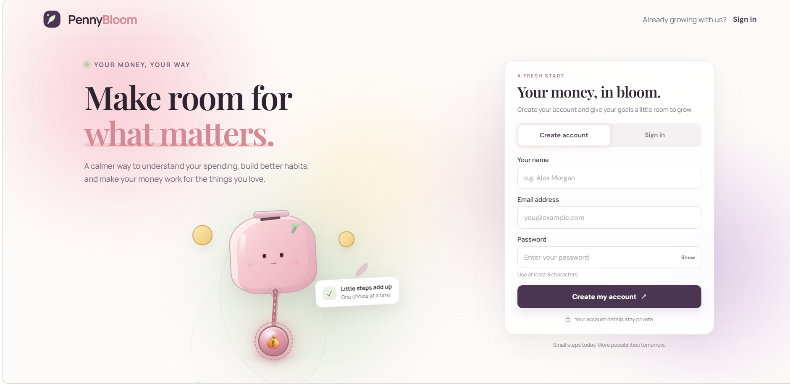
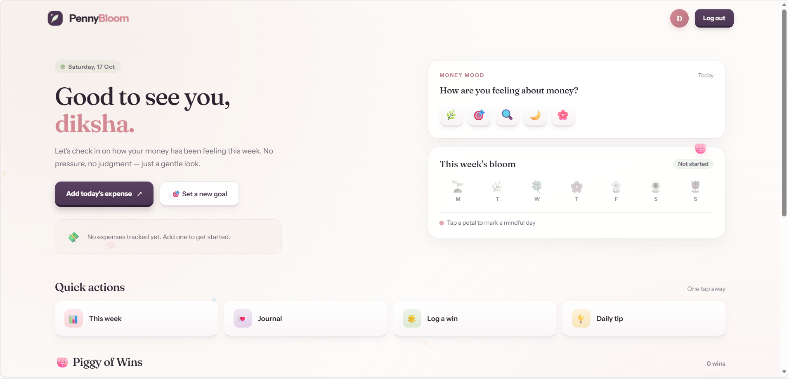

<div align="center">

# 💰 PennyBloom

### *A calmer way to understand your spending.*



**Not just another expense tracker.**
An experience designed to make you *want* to check your money.

[Features](#-why-pennybloom-is-different) • [Screenshots](#-screenshots) • [Tech Stack](#-tech-stack) • [Setup](#-getting-started)

</div>

---

## 🌸 Why PennyBloom is Different

Most expense trackers look like **spreadsheets with a login page**.

They work. They're functional. But they're **boring**.

You open them once, feel guilty about your spending, and never come back.

**PennyBloom is built on a different belief:**

> Money apps shouldn't feel like a punishment.
> They should feel like a *place you want to visit*.

Every pixel, every animation, every micro-interaction in PennyBloom is designed with one goal:

**Make the user smile. Make them curious. Make them stay.**

This isn't a feature-first app.
This is a **feeling-first** app.

---

## ✨ The "Boring Tracker" vs PennyBloom

| Normal Expense Tracker | PennyBloom |
|------------------------|------------|
| Plain table of expenses | 🐷 Animated piggy bank you can **play with** |
| Static login form | 🎭 3D tilting auth card that **follows your mouse** |
| Flat gray background | 🌈 Soft animated **aurora blobs** |
| No personality | 😊 Piggy bank that **blinks, smiles, and reacts** |
| Silent buttons | 🎵 **Sound effects** when coins burst out |
| Just numbers | 💫 Coins with **real physics**, gravity, and bounce |
| "Submit" buttons | ✨ Buttons with **ripple shine effects** |
| No emotion | ❤️ A character that **feels alive** |

**Same features. Completely different experience.**

---

## 🎨 Design Philosophy

PennyBloom is built around **three principles**:

### 1. 🎯 Micro-Interactions Matter
Every hover, every click, every drag has a **response**.
- Eyes follow your cursor
- Cards tilt in 3D
- Buttons ripple with light
- Coins bounce with physics

### 2. 🌊 Motion With Meaning
Animations aren't decoration — they're **communication**.
- Piggy bank *stretches* when you pull the rope (shows effort)
- Coins *burst upward* then fall (shows reward)
- Happy face appears when you succeed (shows celebration)
- Soft aurora background *breathes* (creates calm)

### 3. 💗 Emotional Design
The app should make you feel something.
- Not guilt. Not stress.
- **Curiosity. Delight. Calm.**

That's why there's a **smiling piggy bank** instead of a **chart**.

---

## 🎬 What Makes It Interactive

### 🐷 The Living Piggy Bank
- **Custom CSS illustration** (no images, no SVGs — pure code)
- **Eyes track your mouse** as you move around the screen
- **Blinks randomly** every few seconds
- **Squishes and stretches** when you pull the rope
- **Happy face** appears when you succeed
- **Cheeks glow** with a soft pulse animation

### 🪢 The Pull Rope Mechanic
- Drag the **💰 grip** downward
- Watch the **rope stretch** in real-time (SVG path animation)
- Piggy bank **reacts physically** to your pull
- Release it and watch **coins explode** with real gravity
- **Counter floats up** showing how much you "saved"
- **Sound effect** plays with each coin burst

### 🎴 The 3D Auth Card
- Card **tilts in 3D** as you move your mouse
- **Shine effect** follows your cursor
- Smooth **cubic-bezier** easing everywhere
- Feels **tactile** — like holding a real card

### 🌈 The Aurora Background
- 5 animated **gradient blobs**
- Slowly float and morph in the background
- Creates a **calm, dreamy** atmosphere
- Blurred to feel like **soft light**, not noise

---

## 📸 Screenshots

### 🎨 Signup Page — First Impression

*Soft aurora background, animated piggy bank, 3D tilt card*

### 🏠 Welcome Page — After Login

*Personalized dashboard with your name*

---

## 🛠️ Tech Stack

### Frontend


- **React 18** — Component-based UI
- **Vite** — Lightning-fast build tool
- **Pure CSS3** — Custom animations, no frameworks
- **React Hooks** — `useState`, `useEffect`, `useRef`, `useLayoutEffect`
- **SVG Manipulation** — Dynamic rope rendering
- **Web Audio API** — Coin sound synthesis

### Backend


- **FastAPI** — Modern Python web framework
- **JWT Authentication** — Secure token-based auth
- **SQLAlchemy** — Database ORM
- **SQLite / PostgreSQL** — Data storage

---

## 🚀 Getting Started

### Prerequisites
```bash
Node.js v16+
npm or yarn
Python 3.8+ (for backend)
🎨 Frontend Setup
1. Clone the repository

bash
git clone https://github.com/dikshitaaa/expense-tracker.git
cd expense-tracker/frontend
2. Install dependencies

bash
npm install
3. Start the dev server

bash
npm run dev
4. Open in your browser

text
http://localhost:5173
⚙️ Backend Setup
1. Navigate to root folder

bash
cd expense-tracker
2. Create virtual environment

bash
python -m venv venv

# Activate it:
source venv/bin/activate       # Mac/Linux
venv\Scripts\activate          # Windows
3. Install dependencies

bash
pip install fastapi uvicorn sqlalchemy python-jose[cryptography] passlib[bcrypt] python-multipart
4. Start the server

bash
uvicorn main:app --reload --port 8000
5. API is now running at

text
http://127.0.0.1:8000
📁 Project Structure
text
expense-tracker/
│
├── frontend/
│   ├── public/
│   ├── src/
│   │   ├── App.jsx              # Main app — auth + interactive piggy bank
│   │   ├── App.css              # All styling, animations, keyframes
│   │   ├── WelcomePage.jsx      # Post-login dashboard
│   │   ├── WelcomePage.css      # Dashboard styling
│   │   ├── main.jsx             # React entry point
│   │   └── index.css            # Global styles & resets
│   ├── index.html
│   ├── package.json
│   └── vite.config.js
│
├── backend/
│   ├── main.py                  # FastAPI app + routes
│   ├── database.py              # DB connection setup
│   ├── models.py                # SQLAlchemy models
│   ├── schemas.py               # Pydantic schemas
│   ├── security.py              # JWT auth logic
│   └── reset_db.py              # Database reset script
│
├── screenshots/
│   ├── signup.png               # Signup page screenshot
│   └── welcomepage.png          # Welcome page screenshot
│
├── .gitignore                   # Root git ignore
└── README.md                    # You are here
🔐 API Endpoints
Method	Endpoint	Description
GET	/	Health check
POST	/auth/register	Create new account
POST	/auth/login	Login with credentials
💡 What I Learned Building This
🎨 CSS can do more than you think — the piggy bank is 100% CSS, no images

🎯 Micro-interactions matter — small details create big impressions

🌊 Motion should be meaningful — every animation tells a story

💗 Emotion beats features — users remember how it made them feel

⚡ Performance matters — using requestAnimationFrame and will-change

🔒 Security — JWT tokens, password hashing, CORS

🚧 Roadmap
□ 📊 Expense dashboard with beautiful charts
□ 🎯 Goal tracking with animated progress bars
□ 🌙 Dark mode with smooth transitions
□ 📱 Mobile app (React Native)
□ 🏆 Achievement system with rewards
□ 🎨 Theme customization
<div align="center">
⭐ If PennyBloom made you smile, give it a star! ⭐
Money management doesn't have to be boring.
Let's make it beautiful, one pixel at a time.


Made with 🐷, ☕, and a lot of CSS

</div> ```
